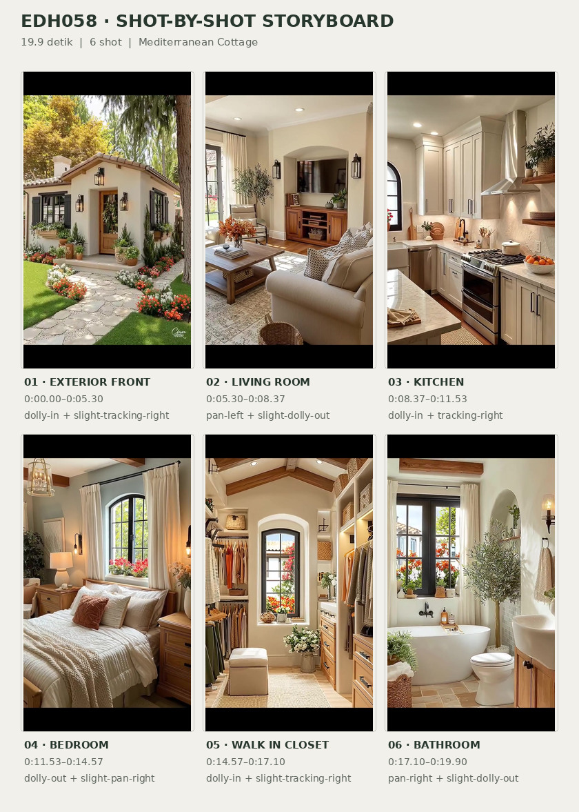
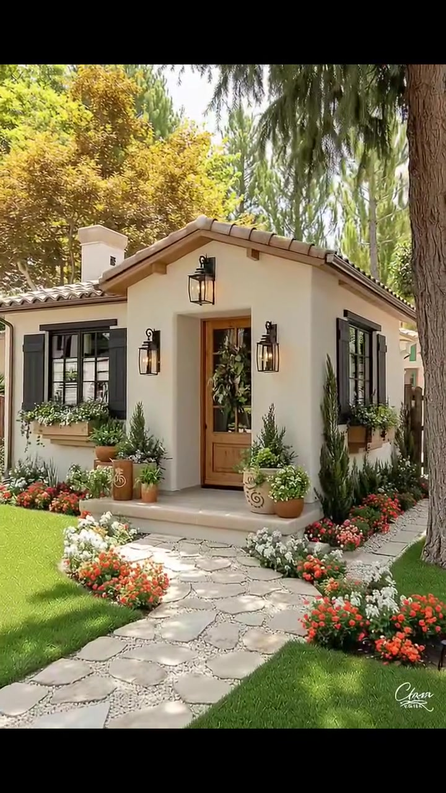
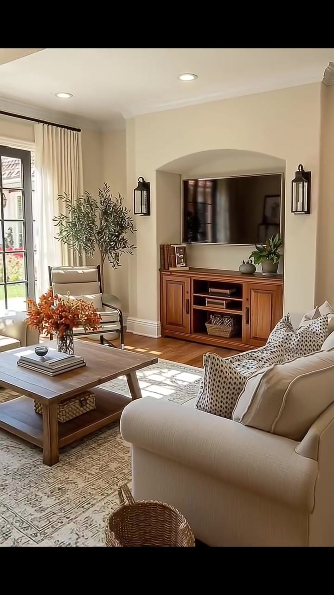
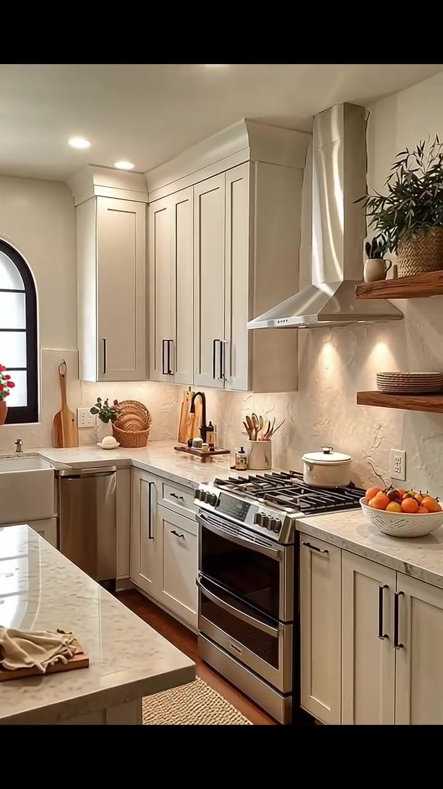
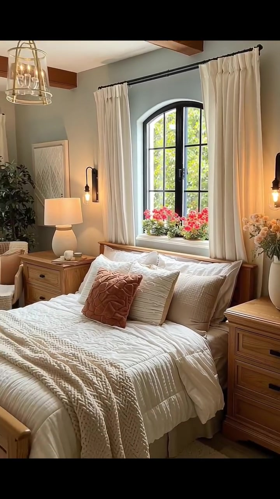
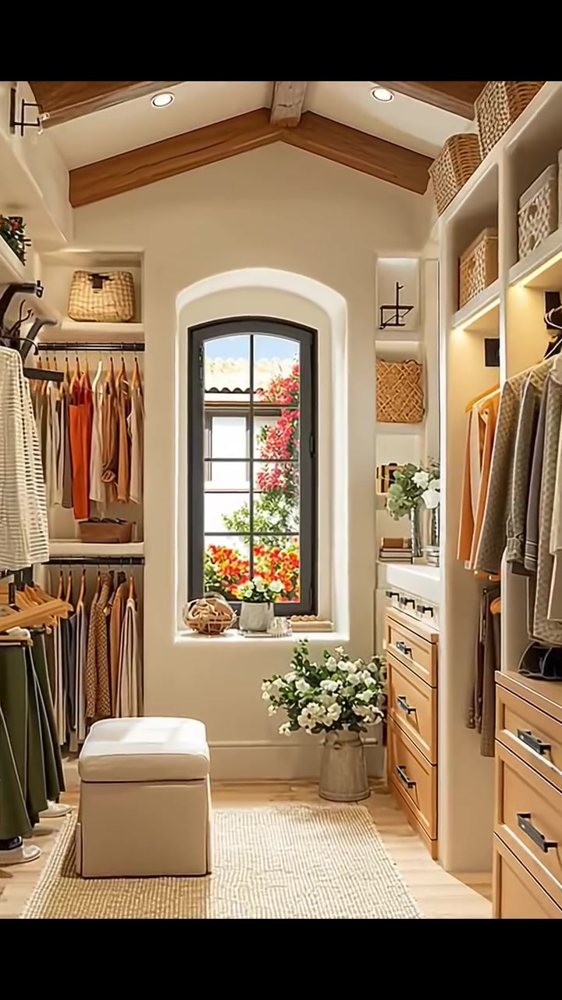
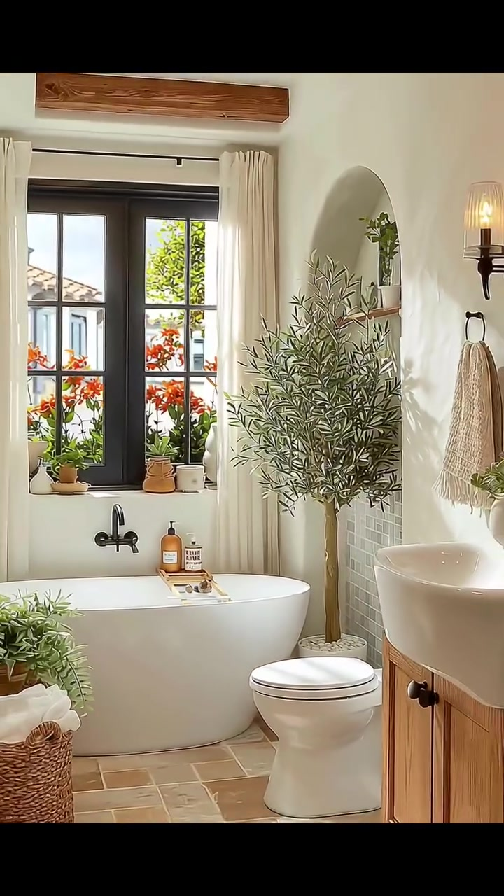

# edh058 — Mediterranean Cottage

<!-- homeku_request_id: edh058_20261106_a2241df20e60ba22106cb60c -->

<!-- homeku_detail_narratives: chat-reviewed -->

**Sumber data:** [analysis.yaml](analysis.yaml) · **Status:** draft · **Diverifikasi manusia:** Tidak

## 1. Informasi Video

| Informasi | Nilai |
|---|---|
| ID | edh058 |
| File asli | edh058.mp4 |
| Durasi | 19.9 |
| Resolusi | 720x1280 |
| FPS | 30 |
| Rasio | 9:16 |
| Jumlah shot | 6 |

## 2. Storyboard Gabungan

## 3. Identitas Desain

| Aspek | Hasil analisis |
|---|---|
| Gaya utama | mediterranean cottage |
| Wilayah terkait gaya desain | europe, north america |
| Pengaruh gaya | mediterranean revival, rustic european country, warm transitional interior |
| Ciri eksterior | cream stucco appearance exterior walls, low pitched terracotta tiled gable roofs, single story form with projecting front entry gable, black framed windows with dark shutters, natural wood glazed entry door, black metal lantern style exterior lights, small light colored chimney at left roofline, shallow raised front entry porch |
| Gaya interior | warm transitional, rustic natural wood accents, neutral layered textiles, black metal fixtures, arched openings and black framed windows |
| Confidence gaya | medium |

## 4. Ukuran & Proporsi Bangunan

| Aspek | Estimasi visual |
|---|---|
| Ukuran yang terlihat | small |
| Bentuk bangunan | irregular rectangular with projecting entry gable |
| Skala vertikal | single story |
| Tapak bangunan | compact |
| Perkiraan luas lantai | 70–130 m² |
| Confidence | low |

> Luas adalah perkiraan visual, bukan ukuran terukur.

## 5. Warna, Pencahayaan, dan Atmosfer

| Warna dominan | HEX (perkiraan) |
|---|---|
| warm ivory | #EDE5D5 |
| soft cream | #D9CBB5 |
| natural honey wood | #AF8257 |
| charcoal black | #2D302C |
| terracotta | #BE7952 |
| foliage green | #5B7041 |

| Aspek | Hasil analisis |
|---|---|
| Pencahayaan | bright direct sunlight on exterior, soft daylight through windows, warm recessed ceiling lighting, warm wall sconces and table lamps |
| Lingkungan | manicured front lawn, curved irregular stone entrance path, flower beds with white orange and red blooms, mature trees surrounding house, greenery and flowering plants visible through interior windows |
| Musim yang tampak | Tidak diketahui |
| Mood | inviting, sunlit, cozy, warm, orderly |

## 6. Struktur dan Timeline Video

**Jenis:** home tour · **Tempo:** slow · **Transisi:** straight cuts between slow moving shots

| Shot | Waktu (detik) | Durasi | Area/Scene | Gerakan Kamera |
|---|---|---|---|---|
| Shot 01 | 0.0–5.3 | 5.30 | exterior front | dolly in, slight tracking right |
| Shot 02 | 5.3–8.367 | 3.07 | living room | pan left, slight dolly out |
| Shot 03 | 8.367–11.533 | 3.17 | kitchen | dolly in, tracking right |
| Shot 04 | 11.533–14.567 | 3.03 | bedroom | dolly out, slight pan right |
| Shot 05 | 14.567–17.1 | 2.53 | walk in closet | dolly in, slight tracking right |
| Shot 06 | 17.1–19.9 | 2.80 | bathroom | pan right, slight dolly out |

## 7. Analisis per Shot

### Shot 01 — exterior front

**Waktu:** 0.0–5.3 detik

| Komponen | Pengamatan |
|---|---|
| Fokus utama | front gabled cottage entry and landscaped walkway |
| Framing awal → akhir | wide front three quarter view from lawn → medium close view of front entry |
| Sudut pandang | front right three quarter to frontal |
| Gerakan kamera | dolly in, slight tracking right |
| Kecepatan kamera | slow |
| Pencahayaan | bright daylight with crisp shadows |
| Transisi keluar | hard cut |

**Detail yang terlihat**

**Arsitektur**

Rumah kecil satu lantai ini memiliki dinding luar krem dengan tampilan menyerupai stucco serta atap pelana landai dengan genteng bernuansa terakota. Di bagian atap sebelah kiri terlihat cerobong kecil berwarna terang. Pintu depan kayu cokelat madu berpanel kaca dihiasi karangan dedaunan, dengan dua lentera dinding hitam di kanan\-kirinya dan satu lampu gantung di atas. Jendela\-jendela berbingkai hitam memiliki daun penutup berwarna gelap, sementara pintu masuk berada pada ceruk dengan anak tangga rendah berlapis ubin. Kotak tanaman dari kayu terpasang di bawah jendela depan.

**Furnitur dan properti**

Di sekitar pintu masuk terdapat beberapa pot tanaman terakota dan pot dekoratif. Semak hijau yang tinggi dan ramping tersusun di dekat pintu serta jendela.

**Lingkungan**

Jalur masuk berbatu terang melengkung dari halaman rumput hijau menuju pintu depan. Di kedua sisi jalur, hamparan bunga putih, jingga, dan merah terlihat padat. Sebatang pohon tinggi berdiri di kanan depan, dengan cabang berdaun hijau menjuntai ke atas komposisi, sedangkan pepohonan lain di belakang rumah memiliki dedaunan hijau bercampur kuning. Pagar kayu berpola bilah vertikal tampak di bagian kanan belakang. Cahaya matahari terang membentuk bayangan pepohonan pada rumput dan batu.

**Catatan pengamatan:** The camera steadily approaches the entrance; the right-side tree trunk and pots frame the front elevation. Roof tile, wall finish and planting species are interpreted by visual appearance.

**Confidence:** Kamera high · Detail visual high

### Shot 02 — living room

**Waktu:** 5.3–8.367 detik

| Komponen | Pengamatan |
|---|---|
| Fokus utama | cream seating area facing wood media cabinet |
| Framing awal → akhir | medium view of tv recess and sofa → wider left revealing view of window and seating area |
| Sudut pandang | eye level interior |
| Gerakan kamera | pan left, slight dolly out |
| Kecepatan kamera | slow |
| Pencahayaan | bright window daylight with warm recessed ceiling lights |
| Transisi keluar | hard cut |

**Detail yang terlihat**

**Arsitektur**

Ruang keluarga memakai dinding krem hangat dengan lis plafon putih dan lantai papan kayu cokelat sedang. Sebuah ceruk dinding berlengkung lebar menjadi area televisi, dengan kolom krem di sisi kanannya. Pada sisi kiri terdapat bukaan kaca tinggi bersekat hitam yang dibingkai tirai krem sepanjang lantai. Plafon putih memiliki lampu tanam bundar, dan sebuah balok kayu gelap mulai terlihat di bagian atas menjelang akhir shot.

**Furnitur dan properti**

Televisi layar datar hitam terpasang di atas kabinet media kayu cokelat. Sofa kain krem di sebelah kanan dihiasi bantal bermotif netral, menghadap meja kopi kayu persegi panjang di atas karpet bermotif warna terang. Di atas meja terdapat vas berisi bunga berwarna jingga kecokelatan bersama tumpukan buku. Sebuah kursi berlengan berlapis kain terang berada dekat jendela, dengan tanaman menyerupai zaitun dalam pot di sampingnya. Keranjang anyaman bundar terletak di lantai dekat sofa, sementara tempat duduk dekat jendela dilengkapi bantal terang dengan aksen jingga bata.

**Lingkungan**

Dari bukaan kaca sebelah kiri terlihat tanaman hijau dan bunga berwarna cerah di luar. Cahaya yang masuk juga menciptakan petak terang serta bayangan kisi jendela pada lantai kayu dan karpet.

**Catatan pengamatan:** Leftward camera reveal changes the composition from TV alcove and near sofa to the window, armchair, rug, and coffee table.

**Confidence:** Kamera medium · Detail visual high

### Shot 03 — kitchen

**Waktu:** 8.367–11.533 detik

| Komponen | Pengamatan |
|---|---|
| Fokus utama | white shaker cabinetry stainless range and stone appearance worktop |
| Framing awal → akhir | wide view including peninsula and arched back window → medium close view of range hood and cabinetry |
| Sudut pandang | eye level from kitchen aisle |
| Gerakan kamera | dolly in, tracking right |
| Kecepatan kamera | slow |
| Pencahayaan | bright daylight mixed with warm ceiling and under hood lighting |
| Transisi keluar | hard cut |

**Detail yang terlihat**

**Arsitektur**

Dapur memiliki kabinet model shaker berwarna putih gading dengan gagang panjang berwarna gelap. Permukaan meja dan dinding belakang berpenampilan batu terang dengan gurat halus. Di atas kompor baja nirkarat dengan enam tungku berjeruji hitam dan oven terpasang tudung pengisap baja nirkarat. Jendela berujung lengkung dengan kisi hitam terlihat di bagian belakang kiri. Lantai menggunakan papan kayu cokelat hangat, dua rak kayu terbuka berada di kanan tudung kompor, dan plafon putih memiliki beberapa lampu tanam serta tepian lis sederhana.

**Furnitur dan properti**

Meja semenanjung dengan permukaan terang dan sisi menjorok tampak di bagian kiri depan, dilengkapi dua bangku dudukan kayu bundar dan lampu gantung silinder berwarna pucat di atasnya. Panci putih bertutup berada di atas tungku, sedangkan semangkuk buah jingga berada di meja kanan kompor. Beberapa talenan kayu disandarkan di bagian kiri dinding belakang, bersama keran dapur gelap yang melengkung. Rak kayu terbuka menampung keranjang anyaman dan tanaman hijau. Karpet kecil krem terbentang di depan kabinet, sementara papan kayu dengan benda makanan kecil terlihat di meja semenanjung.

**Lingkungan**

Melalui jendela belakang kiri terlihat bunga merah dan cahaya siang di luar.

**Catatan pengamatan:** The move advances toward the cooking range while cropping the peninsula and black-arched window out of the frame.

**Confidence:** Kamera medium · Detail visual high

### Shot 04 — bedroom

**Waktu:** 11.533–14.567 detik

| Komponen | Pengamatan |
|---|---|
| Fokus utama | wood framed bed under black arched window |
| Framing awal → akhir | close view of bed and arched window → wide view showing bed both nightstands and ceiling beams |
| Sudut pandang | eye level front three quarter |
| Gerakan kamera | dolly out, slight pan right |
| Kecepatan kamera | slow |
| Pencahayaan | soft daylight through window mixed with warm bedside lighting |
| Transisi keluar | hard cut |

**Detail yang terlihat**

**Arsitektur**

Dinding di belakang tempat tidur berwarna biru keabu\-abuan pucat, dengan jendela tinggi berujung lengkung dan berkisi hitam tepat di atas kepala ranjang. Tirai krem panjang membingkai jendela tersebut. Balok kayu bernuansa hangat melintang pada plafon putih, sementara dinding samping berwarna krem terang dengan lis sederhana. Rangka kepala dan kaki ranjang tampak terbuat dari kayu cokelat madu, dan lampu dinding berwarna gelap dengan bohlam hangat dipasang di sisi area tidur.

**Furnitur dan properti**

Tempat tidur berlapis duvet putih bertekstur dilengkapi bantal\-bantal krem dan sebuah bantal dekoratif berwarna jingga bata di tengah. Selimut rajut krem tebal menjuntai di bagian depan. Dua nakas laci dari kayu alami berada di kiri dan kanan, dengan lampu meja keramik berkap putih di sisi kiri. Lampu gantung berkerangka anyaman terbuka menggantung di atas. Karpet terang sebagian terselip di bawah ranjang; tanaman dalam pot menyerupai zaitun berada di sudut belakang kiri, rangkaian bunga pucat di atas nakas kanan, dan kursi berlapis kain netral dekat dinding kiri.

**Lingkungan**

Bunga merah muda hingga merah terlihat di kotak tanam atau pot di luar jendela lengkung. Dedaunan pohon hijau tampak lebih jauh di balik kaca.

**Catatan pengamatan:** The shot widens and shifts slightly right, showing wood ceiling beams and both sides of the bed. Bedding and wall colors are described visually.

**Confidence:** Kamera medium · Detail visual high

### Shot 05 — walk in closet

**Waktu:** 14.567–17.1 detik

| Komponen | Pengamatan |
|---|---|
| Fokus utama | symmetrical walk in closet with clothing storage and rear arched window |
| Framing awal → akhir | wide centered view down narrow dressing room → medium view of back arched window and right side storage |
| Sudut pandang | eye level central aisle |
| Gerakan kamera | dolly in, slight tracking right |
| Kecepatan kamera | slow |
| Pencahayaan | soft bright daylight from end window and warm built in lighting |
| Transisi keluar | hard cut |

**Detail yang terlihat**

**Arsitektur**

Ruang ganti berbentuk lorong sempit dengan plafon putih berkubah pelana dan balok\-balok kayu alami yang terekspos. Kabinet terbuka berwarna krem menjulang pada kedua dinding memanjang, dipadukan laci kayu cokelat madu dan palang gantungan pakaian di bawah rak atas. Jendela hitam berujung lengkung berada tepat di ujung lorong, dengan detail bingkai lengkung pada dinding krem. Lantai berwarna beige terang ditutup sebagian karpet netral di tengah. Lampu sorot kecil pada plafon serta lampu dinding logam gelap menerangi rak penyimpanan.

**Furnitur dan properti**

Pakaian berwarna krem, abu\-abu, cokelat, dan jingga bata tergantung rapi di kedua sisi. Beberapa keranjang anyaman terang disusun pada rak\-rak atas. Bangku ottoman kecil persegi panjang berlapis kain krem ditempatkan di tengah lorong. Di dekat ujung ruangan terlihat vas bunga putih di sisi kanan, pot tanaman hijau dan bunga putih lain di sekitar jendela, serta lipatan pakaian dan wadah penyimpanan kecil pada rak.

**Lingkungan**

Bunga jingga kemerahan bersama dedaunan hijau terlihat melalui jendela belakang. Di kejauhan tampak pula sebagian garis atap bangunan berwarna pucat.

**Catatan pengamatan:** Camera slowly moves toward the rear window; both storage walls are visible at start and right cabinets fill more of the end frame.

**Confidence:** Kamera medium · Detail visual high

### Shot 06 — bathroom

**Waktu:** 17.1–19.9 detik

| Komponen | Pengamatan |
|---|---|
| Fokus utama | freestanding white tub and wood vanity below black window |
| Framing awal → akhir | medium view of tub window and potted tree → wide right revealing view including toilet vanity and mirror |
| Sudut pandang | eye level interior |
| Gerakan kamera | pan right, slight dolly out |
| Kecepatan kamera | slow |
| Pencahayaan | bright natural window daylight with warm wall sconce |
| Transisi keluar | end of video |

**Detail yang terlihat**

**Arsitektur**

Kamar mandi mempunyai dinding putih hangat dengan ceruk rak berujung lengkung. Jendela bersekat hitam yang terdiri dari dua daun berada di atas bak mandi dan dibingkai tirai krem. Sebagian dinding di belakang bak dan pohon memiliki ubin kecil berwarna terang. Balok kayu hangat terlihat di plafon, dengan lantai ubin persegi dalam nuansa beige dan cokelat muda yang tersusun berselang. Di kanan tampak kabinet wastafel kayu dengan countertop terang, keran bak mandi hitam yang menempel pada dinding bawah jendela, lampu dinding logam gelap, dan sebagian cermin berbingkai gelap di atas wastafel.

**Furnitur dan properti**

Bak mandi putih berdiri bebas berbentuk oval terletak tepat di bawah jendela, dengan kloset putih di sampingnya. Pohon dalam pot yang menyerupai zaitun berdiri antara bak mandi dan dinding. Di kanan terdapat wastafel mangkuk putih di atas kabinet kayu, serta keranjang lantai anyaman berisi handuk krem terlipat. Tanaman kecil dalam pot berada di ambang jendela dan dekat keranjang, sedangkan dua botol berwarna amber dan bening diletakkan di tepi bak. Handuk tangan krem digantung pada sisi ceruk dinding, tanaman pot putih kecil ada di rak ceruk atas, dan keset kamar mandi berwarna pucat terletak di depan kabinet.

**Lingkungan**

Semak dengan bunga jingga kemerahan dan dedaunan hijau terlihat jelas di balik jendela. Sebagian atap bangunan berwarna terang terlihat lebih jauh melalui kaca.

**Catatan pengamatan:** The camera reveals more bathroom fixtures toward the right, ending with tub, toilet, wood vanity, and part of mirror in one frame.

**Confidence:** Kamera medium · Detail visual high

## 8. Kualitas dan Ketidakpastian Analisis

| Parameter | Hasil |
|---|---|
| Status | draft |
| Verifikasi manusia | Tidak |
| Ketepatan timestamp | frame derived approximate |
| Ketidakpastian | mediterranean cottage is a stylistic interpretation not a verified architectural provenance, common regions are style associations not actual building location, floor area is a low confidence visual estimate without measured dimensions, specific stucco stone wood and fabric materials are described by appearance where uncertain, season cannot be confirmed from sunlight and mixed green yellow foliage, camera moves may include digital zoom or synthetic motion |

**Catatan:** All six shots were reviewed across beginning middle and end; cut timestamps estimated from frame change detection. Visual stream lasts 19.900 s; container duration including audio is about 20.037 s. Audio is not analyzed.

---

*Laporan ini diturunkan dari [analysis.yaml](analysis.yaml).*
