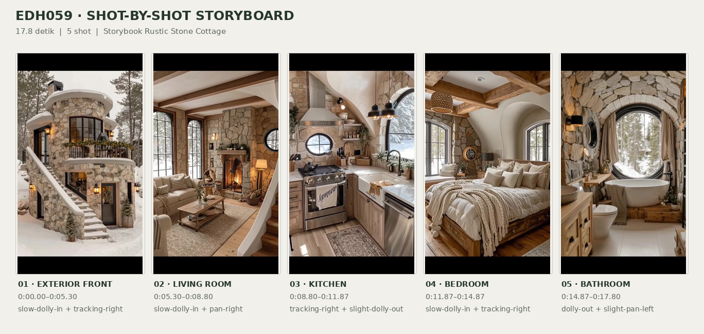
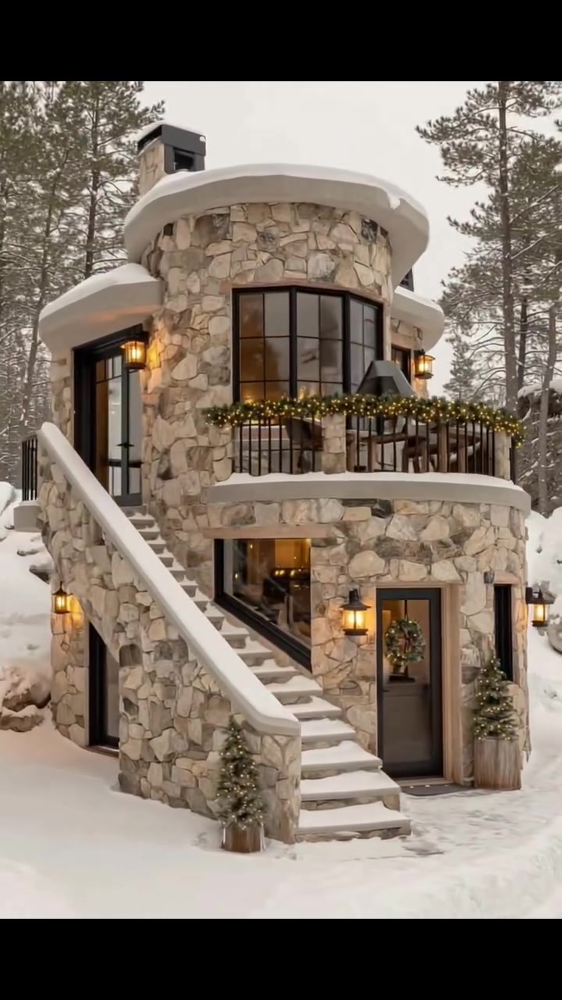
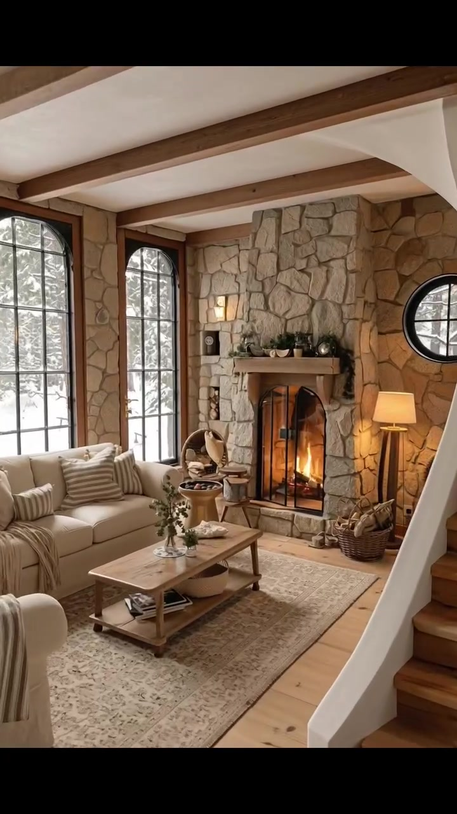
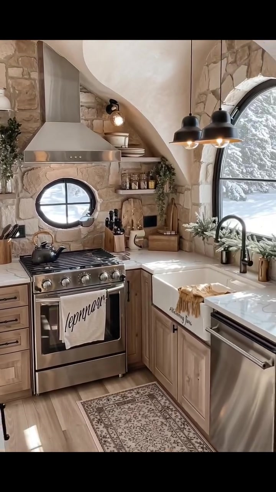
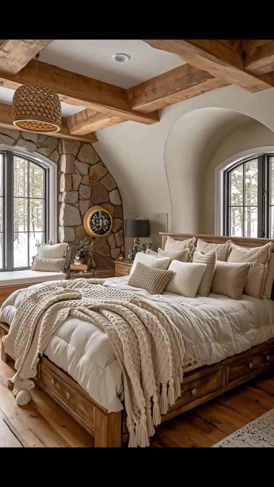
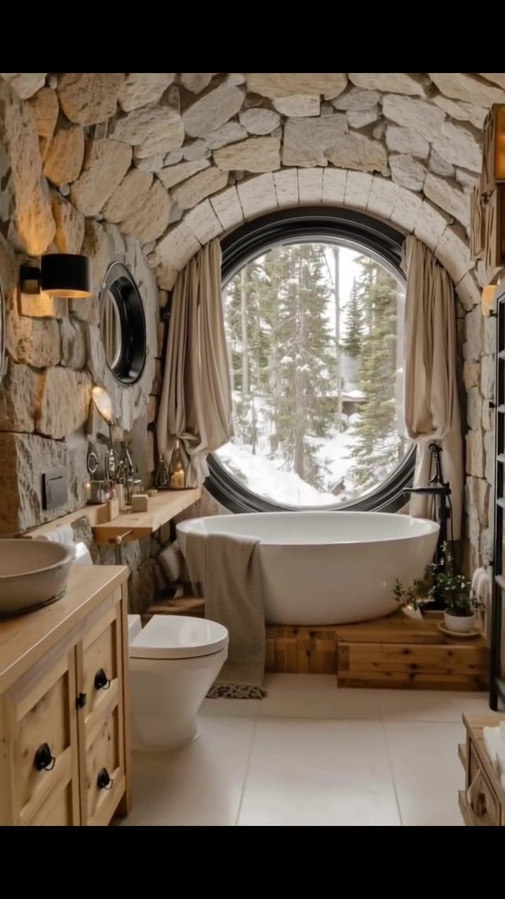

# edh059 — Storybook Rustic Stone Cottage

<!-- homeku_request_id: edh059-20261106-85311bdaf4b87811a04fbaeb -->

<!-- homeku_detail_narratives: chat-reviewed -->

**Sumber data:** [analysis.yaml](analysis.yaml) · **Status:** draft · **Diverifikasi manusia:** Tidak

## 1. Informasi Video

| Informasi | Nilai |
|---|---|
| ID | edh059 |
| File asli | edh059.mp4 |
| Durasi | 17.8 |
| Resolusi | 720x1280 |
| FPS | 30 |
| Rasio | 9:16 |
| Jumlah shot | 5 |

## 2. Storyboard Gabungan

## 3. Identitas Desain

| Aspek | Hasil analisis |
|---|---|
| Gaya utama | storybook rustic stone cottage |
| Wilayah terkait gaya desain | europe, north america |
| Pengaruh gaya | alpine chalet, rustic mountain lodge, fairytale cottage |
| Ciri eksterior | rounded two level stone tower, rough beige gray stone facade, heavy curved snow covered eaves, black grid framed curved windows, semi circular upper balcony, exterior left stairway, warm exterior lanterns |
| Gaya interior | rustic warm neutral, natural stone accents, exposed wood beams, curved and circular windows, cozy layered textiles |
| Confidence gaya | medium |

## 4. Ukuran & Proporsi Bangunan

| Aspek | Estimasi visual |
|---|---|
| Ukuran yang terlihat | medium |
| Bentuk bangunan | compact irregular plan with rounded front tower |
| Skala vertikal | two story appearance |
| Tapak bangunan | compact |
| Perkiraan luas lantai | 90–170 m² |
| Confidence | low |

> Luas adalah perkiraan visual, bukan ukuran terukur.

## 5. Warna, Pencahayaan, dan Atmosfer

| Warna dominan | HEX (perkiraan) |
|---|---|
| light stone beige | #B2A596 |
| snow white | #EEEDE8 |
| warm honey wood | #B68960 |
| soft cream | #E4D8C7 |
| charcoal black | #292B2B |
| evergreen green | #566451 |

| Aspek | Hasil analisis |
|---|---|
| Pencahayaan | soft overcast exterior daylight, cool daylight through windows, warm interior practical lights, warm fireplace glow |
| Lingkungan | snow covered conifer forest, rocky snow banks, isolated woodland house appearance |
| Musim yang tampak | snowy winter appearance |
| Mood | cozy, rustic, warm, tranquil, wintery |

## 6. Struktur dan Timeline Video

**Jenis:** home tour · **Tempo:** slow · **Transisi:** hard cuts

| Shot | Waktu (detik) | Durasi | Area/Scene | Gerakan Kamera |
|---|---|---|---|---|
| Shot 01 | 0.0–5.3 | 5.30 | exterior front | slow dolly in, tracking right |
| Shot 02 | 5.3–8.8 | 3.50 | living room | slow dolly in, pan right |
| Shot 03 | 8.8–11.87 | 3.07 | kitchen | tracking right, slight dolly out |
| Shot 04 | 11.87–14.87 | 3.00 | bedroom | slow dolly in, tracking right |
| Shot 05 | 14.87–17.8 | 2.93 | bathroom | dolly out, slight pan left |

## 7. Analisis per Shot

### Shot 01 — exterior front

**Waktu:** 0.0–5.3 detik

| Komponen | Pengamatan |
|---|---|
| Fokus utama | two level rounded stone house with external stair and balcony |
| Framing awal → akhir | wide three quarter front elevation → medium front elevation focused on entry and balcony |
| Sudut pandang | slightly low front three quarter |
| Gerakan kamera | slow dolly in, tracking right |
| Kecepatan kamera | slow |
| Pencahayaan | soft overcast daylight with warm amber exterior lanterns and balcony lights |
| Transisi keluar | hard cut |

**Detail yang terlihat**

**Arsitektur**

Bangunan tampak kompak dengan dua tingkat dan massa depan berbentuk menara membulat. Fasadnya dilapisi susunan batu tak beraturan bernuansa krem dan abu\-abu, sementara tepian atap yang melengkung tertutup salju putih. Jendela besar berbingkai hitam dengan pembagi kisi mengikuti lengkung lantai atas. Di depannya ada balkon melengkung dengan pagar logam hitam vertikal. Tangga luar berbahan batu memanjang di sisi kiri menuju akses masuk lantai atas, yang memiliki pintu gelap dan lentera dinding hangat. Di lantai bawah terlihat pintu depan berkaca dengan bingkai gelap serta lis bernuansa kayu; sebuah jendela miring berada di bawah tangga dan satu jendela sempit berada di kanan pintu. Sepasang lentera dinding berbingkai gelap menyala hangat di dekat pintu bawah. Tonjolan gelap menyerupai cerobong tampak di belakang tepian atap.

**Furnitur dan properti**

Balkon atas dihiasi untaian dedaunan hijau dengan lampu\-lampu kecil hangat pada pagar. Pintu kaca bawah memajang karangan daun bundar. Pohon cemara kecil berhias ditempatkan dalam pot kayu di kanan pintu, sementara tanaman cemara kecil dalam pot lain berada dekat kaki tangga. Di balik pagar balkon tampak samar furnitur duduk luar ruang berwarna gelap.

**Lingkungan**

Salju putih tebal menutupi halaman, tepian anak tangga, dan atap. Pohon\-pohon konifer tinggi mengelilingi rumah dan menjulang di atasnya. Pada awal shot, beberapa batang pohon bersalju di depan sisi kanan menutupi sebagian bangunan. Di kanan rumah tampak gundukan salju dan bebatuan membulat. Langit pucat berawan terlihat di balik tajuk pepohonan.

**Catatan pengamatan:** Kamera mendekat dan bergeser ke kanan; batang pohon di depan bergeser keluar dari bidang pandang sehingga pintu bawah dan balkon tampak lebih jelas.

**Confidence:** Kamera medium · Detail visual high

### Shot 02 — living room

**Waktu:** 5.3–8.8 detik

| Komponen | Pengamatan |
|---|---|
| Fokus utama | arched fireplace set into full height stone wall |
| Framing awal → akhir | wide living room from stair side → medium close view centered on stone fireplace |
| Sudut pandang | eye level slightly oblique |
| Gerakan kamera | slow dolly in, pan right |
| Kecepatan kamera | slow |
| Pencahayaan | diffused cool daylight from tall windows with warm firelight and lamps |
| Transisi keluar | hard cut |

**Detail yang terlihat**

**Arsitektur**

Dinding aksen batu alam berwarna terang membingkai perapian dan menjulang tinggi. Di sebelah kiri berdiri jendela\-jendela tinggi berbentuk lengkung dengan bingkai kisi hitam; jendela bundar kecil dengan bingkai hitam terlihat di dinding kanan perapian. Balok kayu cokelat terekspos membentang di antara bidang plafon putih, sedangkan lantainya berupa papan lebar berwarna kayu madu terang. Bukaan perapian berbentuk lengkung dilindungi layar kaca berbingkai logam hitam, dengan ambalan kayu tebal di atasnya. Tangga kayu dan dinding sisi melengkung putih tampak di tepi kanan. Di kiri perapian terdapat ceruk kecil untuk menyimpan kayu bakar.

**Furnitur dan properti**

Sofa berlapis kain krem di bawah jendela kiri memiliki bantal\-bantal bermotif garis netral. Kursi berlengan krem di depan kiri diberi kain selimut bergaris. Di tengah area duduk terdapat meja kopi kayu terang berbentuk persegi panjang dengan dua tingkat, di atas karpet besar berwarna beige pucat bermotif halus. Vas bening berisi tanaman dan sejumlah buku berada di meja. Api menyala di dalam perapian. Ambalan di atasnya ditata dengan dedaunan, wadah kecil, dan jam bundar. Lampu berdiri bertudung hangat berada di kanan perapian, bersebelahan dengan keranjang anyaman berisi kayu bakar. Di kiri perapian tampak kursi aksen anyaman dan bangku kayu kecil, serta wadah bundar rendah dengan isi berwarna gelap. Lampu yang menempel pada dinding juga terlihat di dekat jendela.

**Lingkungan**

Dari jendela\-jendela lengkung sebelah kiri terlihat pohon\-pohon konifer yang tertutup salju.

**Catatan pengamatan:** Framing bergeser mendekati perapian; sofa dan anak tangga semakin tersisih dari tepi bidang saat dinding batu menjadi dominan.

**Confidence:** Kamera medium · Detail visual high

### Shot 03 — kitchen

**Waktu:** 8.8–11.87 detik

| Komponen | Pengamatan |
|---|---|
| Fokus utama | stainless range and farmhouse sink below arched window |
| Framing awal → akhir | medium view of cooking range and stone wall → wide kitchen view including sink and dishwasher |
| Sudut pandang | eye level front oblique |
| Gerakan kamera | tracking right, slight dolly out |
| Kecepatan kamera | slow |
| Pencahayaan | bright cool window daylight with warm pendant and wall lights |
| Transisi keluar | hard cut |

**Detail yang terlihat**

**Arsitektur**

Bidang belakang kompor ditutup susunan batu berwarna beige tak beraturan, dengan jendela bundar kecil berbingkai hitam dan berpalang silang di atasnya. Di atas bak cuci terdapat jendela besar melengkung dengan bingkai hitam. Plafon diplester putih dan membentuk lengkungan lembut di antara dua area kerja. Kabinet kayu alami berwarna terang menggunakan tarikan logam gelap, dengan countertop putih yang tampak seperti marmer berurat abu\-abu samar. Bak cuci putih model farmhouse memiliki bagian depan menonjol, tepat di bawah jendela lengkung, dilengkapi keran hitam leher angsa. Lantai menggunakan papan bernuansa kayu pucat.

**Furnitur dan properti**

Kompor oven berbahan stainless steel dilengkapi jeruji tungku hitam dan kenop di depan, dengan tudung pengisap logam besar bersudut di atasnya. Ketel hitam berada di atas tungku dan kain lap putih bertulisan dekoratif menggantung dari gagang oven. Dua lampu gantung hitam berbentuk kubah berada di sisi bak cuci. Rak terbuka kecil menata piring putih, stoples kaca, dan botol; di dekatnya terdapat lampu dinding dengan pelindung logam hitam. Balok pisau, talenan, dan wadah\-wadah kecil tersusun di countertop. Tanaman hijau menjuntai menghiasi rak dan sisi jendela. Mesin pencuci piring berlapis stainless steel berada di bawah countertop kanan, dengan karpet runner panjang bermotif terang di lantai. Kain lap berwarna hangat tersampir pada bagian depan bak cuci.

**Lingkungan**

Pohon\-pohon konifer bersalju terlihat melalui jendela bundar kecil dan jendela lengkung besar.

**Catatan pengamatan:** Area yang awalnya menonjolkan kompor dan jendela bundar melebar ke kanan hingga bak cuci, jendela lengkung, dan mesin pencuci piring masuk dalam tampilan.

**Confidence:** Kamera medium · Detail visual high

### Shot 04 — bedroom

**Waktu:** 11.87–14.87 detik

| Komponen | Pengamatan |
|---|---|
| Fokus utama | large wooden storage bed with layered cream bedding |
| Framing awal → akhir | wide three quarter bedroom view → medium close bed and pillows view |
| Sudut pandang | eye level from bed foot side |
| Gerakan kamera | slow dolly in, tracking right |
| Kecepatan kamera | slow |
| Pencahayaan | soft cold daylight through arched windows with warm neutral interior tones |
| Transisi keluar | hard cut |

**Detail yang terlihat**

**Arsitektur**

Balok\-balok kayu alami berukuran tebal bersilangan pada plafon putih. Dinding aksen di sisi kiri memakai batu alam tak beraturan, sementara jendela tinggi melengkung dengan kisi hitam berada di kiri dan kanan ruangan. Jendela kanan terletak dalam cekungan plester putih yang membulat. Lantai tersusun dari papan kayu bernuansa cokelat hangat. Di bawah jendela kiri terdapat dudukan jendela built\-in, dan karpet bernuansa netral terang membentang di kaki tempat tidur.

**Furnitur dan properti**

Tempat tidur besar memakai rangka kayu madu yang relatif rendah, lengkap dengan laci penyimpanan di bagian bawah. Kasur ditata dengan duvet krem tebal dan beberapa lapis bantal krem. Selimut rajut krem yang tebal, bertekstur dan berjumbai tersampir di ujung ranjang. Lemari kecil berkayu terang berlaci berada pada sisi kepala tempat tidur, dengan lampu meja bertudung gelap di sebelah kiri. Lampu gantung anyaman rotan turun dari plafon. Dudukan jendela kiri diberi bantalan dan bantal krem. Hiasan dinding bundar dengan bagian tengah gelap menempel pada dinding batu. Tanaman kecil dan dekorasi netral diletakkan di atas permukaan meja samping ranjang.

**Lingkungan**

Pohon konifer bersalju tampak melalui jendela kamar sebelah kiri, sedangkan hutan bersalju yang pucat terlihat dari jendela lengkung kanan.

**Catatan pengamatan:** Kamera bergerak lebih dekat dan agak ke kanan; bingkai awal menampilkan lantai dan tempat tidur lengkap, sedangkan bagian akhir menekankan bantal dan selimut rajut.

**Confidence:** Kamera medium · Detail visual high

### Shot 05 — bathroom

**Waktu:** 14.87–17.8 detik

| Komponen | Pengamatan |
|---|---|
| Fokus utama | freestanding white bathtub in front of large circular window |
| Framing awal → akhir | tight view of bathtub and large round window → wide bathroom view with vanity and toilet |
| Sudut pandang | eye level front view |
| Gerakan kamera | dolly out, slight pan left |
| Kecepatan kamera | slow |
| Pencahayaan | diffused daylight from circular window with warm wall sconces |
| Transisi keluar | video end |

**Detail yang terlihat**

**Arsitektur**

Jendela panorama besar berbentuk lingkaran memiliki bingkai hitam dan ditanam dalam dinding batu tebal. Batu berwarna beige terang dengan bentuk tidak beraturan membentuk permukaan dinding sekaligus lengkungan di atas jendela. Tirai kain cokelat muda menggantung pada kedua sisi jendela bundar. Bak mandi ditempatkan di atas panggung kayu hangat yang sedikit ditinggikan dengan anak tangga rendah. Lantai depan menggunakan ubin persegi besar berwarna pucat. Jendela bundar kecil lain dengan bingkai hitam berada di sisi kiri bak, dan di ujung kanan tampak bidang berbingkai hitam dengan kaca seperti partisi atau pintu.

**Furnitur dan properti**

Bak mandi rendam berbentuk oval putih berdiri bebas di tengah panggung kayu. Di kanan bak terpasang keran pengisi berdiri berwarna hitam, sementara handuk mandi beige bertekstur tersampir pada bibir depannya. Di sisi kiri depan terdapat kabinet wastafel kayu terang dengan kenop gelap dan basin bulat pucat di atas meja. Sebuah cermin bundar besar tergantung pada dinding kiri di atas kabinet. Toilet putih ringkas berada di antara wastafel dan bak mandi. Botol kaca kecil menata tepi jendela dan rak dekat wastafel. Lampu dinding hitam berbentuk silinder memancarkan cahaya hangat. Tanaman kecil dalam pot hijau diletakkan di tepi panggung bak, dan handuk putih terlipat ada pada penyimpanan kayu rendah di tepi kanan.

**Lingkungan**

Dari jendela bundar besar terlihat hutan konifer yang rapat dengan dahan bersalju. Gundukan salju tebal menumpuk di luar bagian bawah jendela.

**Catatan pengamatan:** Kamera menarik mundur dari bak mandi ke tampilan lebih lebar; meja wastafel, toilet, cermin dan kabinet tepi kanan masuk bertahap ke dalam gambar.

**Confidence:** Kamera medium · Detail visual high

## 8. Kualitas dan Ketidakpastian Analisis

| Parameter | Hasil |
|---|---|
| Status | draft |
| Verifikasi manusia | Tidak |
| Ketepatan timestamp | estimated |
| Ketidakpastian | camera motion may include digital zoom rather than physical dolly, exact stone and wood materials not verified from video, building floor area is low confidence visual estimate, common regions reflect style association not actual location, snow suggests winter scene but not verified date or location, some bathroom right side glazing function is unclear, external roof projections appear chimney like but not confirmed |

**Catatan:** Analisis visual seluruh shot pada video 720x1280 30 fps. Durasi gambar 17.80 detik; durasi kontainer sekitar 17.95 detik termasuk stream lain. Lima potongan terdeteksi di 5.30, 8.80, 11.87, dan 14.87 detik. Belum diverifikasi manusia atau disimpan ke GitHub.

---

*Laporan ini diturunkan dari [analysis.yaml](analysis.yaml).*
