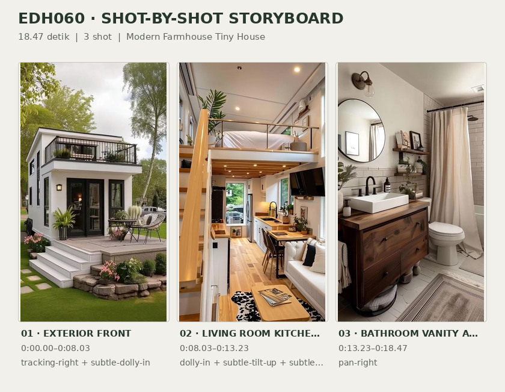
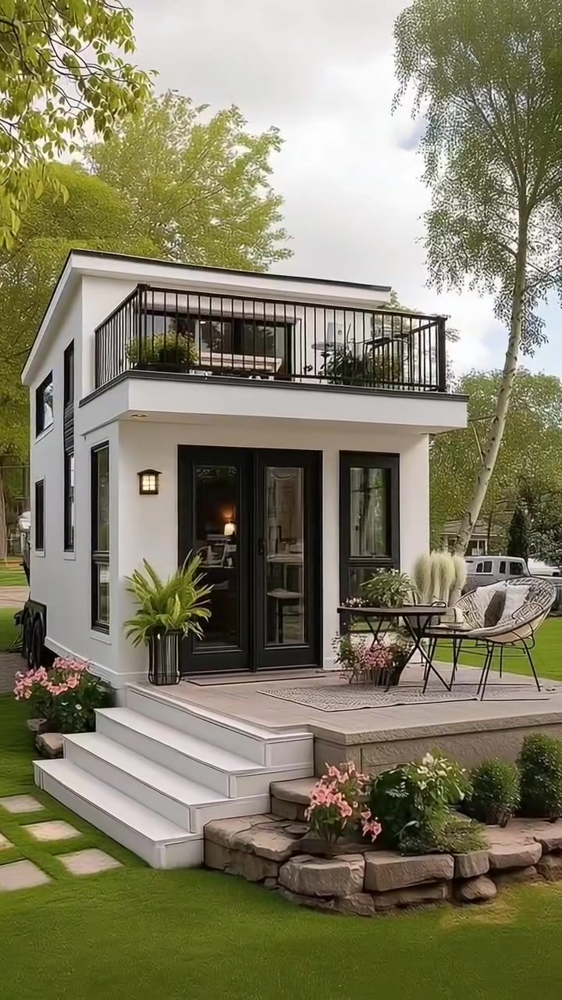
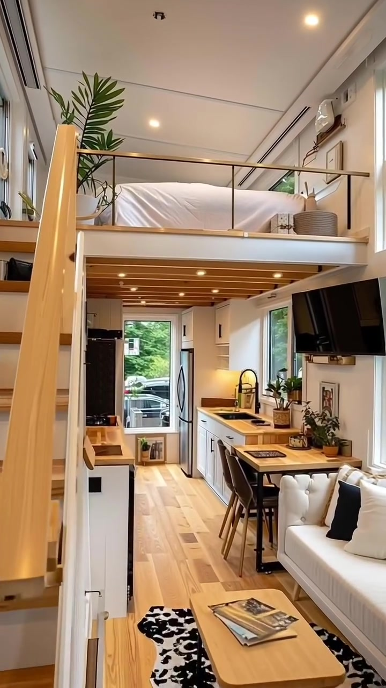
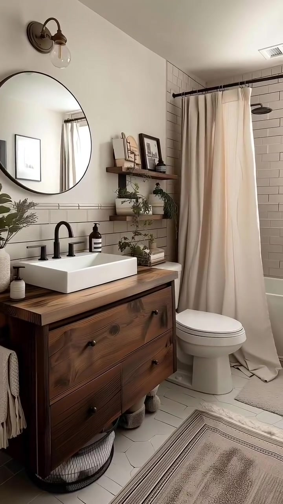

# edh060 — Modern Farmhouse Tiny House

<!-- homeku_request_id: edh060_20261106_1c8961dc -->

<!-- homeku_detail_narratives: chat-reviewed -->

**Sumber data:** [analysis.yaml](analysis.yaml) · **Status:** draft · **Diverifikasi manusia:** Tidak

## 1. Informasi Video

| Informasi | Nilai |
|---|---|
| ID | edh060 |
| File asli | edh060.mp4 |
| Durasi | 18.47 |
| Resolusi | 720x1280 |
| FPS | 30.0 |
| Rasio | 9:16 |
| Jumlah shot | 3 |

## 2. Storyboard Gabungan

## 3. Identitas Desain

| Aspek | Hasil analisis |
|---|---|
| Gaya utama | modern farmhouse tiny house |
| Wilayah terkait gaya desain | north america |
| Pengaruh gaya | contemporary minimalist, scandinavian inspired interior |
| Ciri eksterior | smooth white exterior finish, near flat low pitch roof with dark edge trim, projecting upper roof terrace with black vertical metal railings, black framed glazed entry doors and tall windows, front raised deck with three white steps, black trailer chassis with visible tandem wheels |
| Gaya interior | white and light wood open plan interior, compact galley kitchen, sleeping loft with black metal guardrail, warm wood bathroom vanity with white tiles |
| Confidence gaya | medium |

## 4. Ukuran & Proporsi Bangunan

| Aspek | Estimasi visual |
|---|---|
| Ukuran yang terlihat | small |
| Bentuk bangunan | narrow rectangular trailer based |
| Skala vertikal | single story with sleeping loft and roof terrace |
| Tapak bangunan | compact |
| Perkiraan luas lantai | 25–45 m² |
| Confidence | low |

> Luas adalah perkiraan visual, bukan ukuran terukur.

## 5. Warna, Pencahayaan, dan Atmosfer

| Warna dominan | HEX (perkiraan) |
|---|---|
| warm off white | #F0EEE8 |
| charcoal black | #262626 |
| natural light wood | #C49B6C |
| warm beige | #D7CABB |
| foliage green | #748E55 |
| soft stone gray | #A9AAA2 |

| Aspek | Hasil analisis |
|---|---|
| Pencahayaan | soft overcast daylight on exterior, warm recessed interior ceiling lights, daylight through large windows, warm decorative wall sconces |
| Lingkungan | maintained grass lawn with stepping stones, leafy trees around house, flowerbeds and container plantings, partly cloudy bright sky |
| Musim yang tampak | Tidak diketahui |
| Mood | cozy, bright, orderly, calm |

## 6. Struktur dan Timeline Video

**Jenis:** tiny house visual tour · **Tempo:** slow · **Transisi:** hard cuts between three continuous camera moves

| Shot | Waktu (detik) | Durasi | Area/Scene | Gerakan Kamera |
|---|---|---|---|---|
| Shot 01 | 0.0–8.03 | 8.03 | exterior front | tracking right, subtle dolly in |
| Shot 02 | 8.03–13.23 | 5.20 | living room kitchen and sleeping loft | dolly in, subtle tilt up, subtle pan right |
| Shot 03 | 13.23–18.47 | 5.24 | bathroom vanity and tub shower | pan right |

## 7. Analisis per Shot

### Shot 01 — exterior front

**Waktu:** 0.0–8.03 detik

| Komponen | Pengamatan |
|---|---|
| Fokus utama | white trailer based tiny house with roof terrace and front porch |
| Framing awal → akhir | wide three quarter front left view partly obscured by tree trunks → closer three quarter front view clearing foreground trunks |
| Sudut pandang | slightly low front left angle |
| Gerakan kamera | tracking right, subtle dolly in |
| Kecepatan kamera | slow |
| Pencahayaan | soft diffuse daylight and warm glow from entry lantern |
| Transisi keluar | hard cut |

**Detail yang terlihat**

**Arsitektur**

Rumah kecil berbentuk persegi panjang yang meninggi tampak berdiri di atas rangka trailer hitam dengan beberapa roda yang terlihat di sisi kiri. Dinding luarnya berfinishing putih halus, dengan garis tepi atap gelap dan atap nyaris datar. Di bagian depan atas terdapat teras menjorok dengan pagar logam hitam berbatang vertikal serta bukaan kaca berbingkai gelap di belakangnya. Di lantai bawah, pintu masuk berkaca ganda berbingkai hitam memiliki jendela tinggi dan sempit di sebelah kanan, sementara beberapa jendela lain terlihat di dinding kiri. Dek depan bernuansa kayu abu\-abu ditinggikan dengan tiga anak tangga putih yang lebar. Lentera dinding logam hitam di kiri pintu tampak menyala, sedangkan tepi kanan dek dibatasi susunan batu berpenampilan alami.

**Furnitur dan properti**

Di sisi kanan dek terdapat meja luar ruang bundar kecil berbahan logam hitam yang dikelilingi dua kursi bernuansa terang dengan anyaman dan rangka gelap. Karpet luar ruang persegi panjang bermotif terang berada di bawah kelompok kursi. Tanaman pot berdaun hijau runcing berdiri di kiri pintu masuk, sedangkan rumput hias dalam pot dan tanaman berbunga rendah menghiasi area dekat meja. Beberapa pot tanaman hijau juga tersusun di balik pagar teras atas.

**Lingkungan**

Pada awal shot, dua batang pohon berkulit putih pucat tampak di latar depan sebelah kiri dan tengah, di bawah kanopi dedaunan hijau kekuningan yang menggantung di atas rumah. Pohon gugur dewasa tumbuh di belakang sisi kiri rumah, dengan pohon berbatang ramping yang tinggi di sebelah kanan. Rumah dikelilingi halaman rumput hijau terawat, dan jalur batu pijakan berbentuk persegi menuju anak tangga depan. Tanaman berbunga merah muda mengisi tepian di sekitar tangga dan susunan batu. Di atas pepohonan tampak langit pucat berawan, sedangkan sebuah kendaraan parkir terlihat sebagian di latar belakang kanan.

**Catatan pengamatan:** Kamera bergeser ke kanan sehingga batang pohon yang awalnya menutupi fasad semakin keluar dari bingkai; penafsiran bahan tidak dianggap sebagai spesifikasi pasti.

**Confidence:** Kamera medium · Detail visual high

### Shot 02 — living room kitchen and sleeping loft

**Waktu:** 8.03–13.23 detik

| Komponen | Pengamatan |
|---|---|
| Fokus utama | compact open plan living space under sleeping loft beside galley kitchen |
| Framing awal → akhir | wide eye level view down narrow open plan room with stairs at left → tighter elevated view toward loft bed and far kitchen |
| Sudut pandang | eye level to slightly upward |
| Gerakan kamera | dolly in, subtle tilt up, subtle pan right |
| Kecepatan kamera | slow |
| Pencahayaan | warm ceiling downlights combined with bright window daylight |
| Transisi keluar | hard cut |

**Detail yang terlihat**

**Arsitektur**

Ruang dalam memanjang dengan tata ruang terbuka dan dinding samping putih. Lantai tersusun dari papan bernuansa kayu terang searah panjang ruang, sementara plafon putih dilengkapi beberapa lampu tanam kecil bercahaya hangat. Platform tempat tidur loft berwarna putih berada di atas area duduk, dibatasi pagar logam hitam horizontal dengan pegangan atas bernuansa kayu. Di sebelah kiri, pijakan tangga kayu terang naik menuju loft, dan sisi bawah loft memperlihatkan deretan balok kayu sejajar dengan lampu sorot tanam. Jendela\-jendela tinggi dengan sekeliling berwarna terang berada di dinding kanan. Dapur memanjang memakai kabinet bawah putih dengan pegangan gelap dan countertop berpenampilan kayu terang di sisi kanan serta ujung ruangan.

**Furnitur dan properti**

Tempat tidur di loft tertutup selimut dan bantal putih, dengan tanaman pot berdaun hijau tinggi di dekat sisi kirinya. Sofa berlapis kain putih dengan bantal aksen gelap menempel pada dinding kanan; di depannya ada meja kopi kecil kayu terang berbentuk membulat di atas karpet berpola tidak beraturan hitam\-putih. Meja sarapan sempit bernuansa kayu dengan kursi tinggi gelap berada di dekat dapur. Counter sisi kanan memuat keran hitam melengkung dan bak cuci gelap, sementara kompor berwarna gelap berada di counter seberangnya di bagian depan. Lemari es tinggi abu\-abu keperakan terlihat di ujung ruangan, televisi layar datar hitam terpasang tinggi pada dinding kanan, dan sejumlah tanaman pot kecil beserta perlengkapan dapur menempati countertop.

**Lingkungan**

Pepohonan hijau dan halaman rumput tampak melalui jendela\-jendela besar di sisi kanan. Melalui jendela pada ujung ruangan terlihat sebagian kendaraan gelap yang sedang terparkir.

**Catatan pengamatan:** Bidang pandang makin dekat ke tempat tidur loft dan area dapur; rincian furnitur sisi depan berangsur keluar dari bingkai.

**Confidence:** Kamera medium · Detail visual high

### Shot 03 — bathroom vanity and tub shower

**Waktu:** 13.23–18.47 detik

| Komponen | Pengamatan |
|---|---|
| Fokus utama | compact bathroom with wood vanity toilet and tub shower |
| Framing awal → akhir | medium view of vanity mirror sink and toilet → medium view centered on bathtub window and shower curtains |
| Sudut pandang | eye level slightly downward to floor |
| Gerakan kamera | pan right |
| Kecepatan kamera | slow |
| Pencahayaan | diffuse daylight from bathroom window with warm sconce accent |
| Transisi keluar | video end |

**Detail yang terlihat**

**Arsitektur**

Kamar mandi memiliki dinding bagian atas dan plafon berwarna putih. Dinding di sekitar wastafel dan bak mandi dilapisi ubin pola bata memanjang berwarna terang dengan nat abu\-abu, sedangkan lantai menggunakan ubin putih kecil berbentuk heksagon dengan garis nat gelap. Jendela persegi panjang berbingkai putih berada di tengah dinding di atas bak mandi putih. Batang tirai mandi gelap memanjang di atas bak, dengan kepala pancuran bundar berwarna gelap pada dinding di sebelah kiri jendela. Ventilasi berbentuk persegi panjang tampak pada plafon di atas area mandi.

**Furnitur dan properti**

Di sebelah kiri terdapat kabinet wastafel kayu cokelat sedang hingga gelap dengan dua laci dan knop bulat hitam. Wastafel duduk putih berbentuk persegi panjang diletakkan di atasnya, dengan keran hitam doff dan botol sabun gelap di belakang. Cermin bundar besar berbingkai hitam dipasang di atas wastafel, dengan lampu dinding logam gelap berbohlam kaca terbuka di atasnya. Dua rak kayu melayang memajang foto atau gambar berbingkai kecil dan tanaman hijau. Toilet putih berada di antara kabinet dan bak mandi, sementara tirai mandi panjang berwarna krem terang menggantung di depan bak. Karpet lorong krem bermotif terletak di depan kabinet, alas mandi terang berada dekat bak, dan handuk putih tergantung pada palang gelap di dinding kanan.

**Lingkungan**

Tidak ada detail yang tercatat.

**Catatan pengamatan:** Gerakan ke kanan memperlihatkan kamar mandi dari meja wastafel menuju area bak mandi; pemandangan di luar jendela tidak cukup jelas untuk diidentifikasi.

**Confidence:** Kamera high · Detail visual high

## 8. Kualitas dan Ketidakpastian Analisis

| Parameter | Hasil |
|---|---|
| Status | draft |
| Verifikasi manusia | Tidak |
| Ketepatan timestamp | frame based estimate |
| Ketidakpastian | primary style is visual classification not provenance, common regions are style associations not house location, floor area range is unmeasured visual estimate, surface materials described by appearance not verified composition, season and geographic location cannot be confirmed, camera dolly or zoom component is inferred from relative framing |

**Catatan:** Peninjauan dilakukan pada ketiga shot sepanjang durasi video dan pada beberapa titik di dalam masing-masing shot. Batas potongan terdeteksi dekat frame ke-241 dan ke-397 pada 30 FPS; belum ada verifikasi manusia.

---

*Laporan ini diturunkan dari [analysis.yaml](analysis.yaml).*
